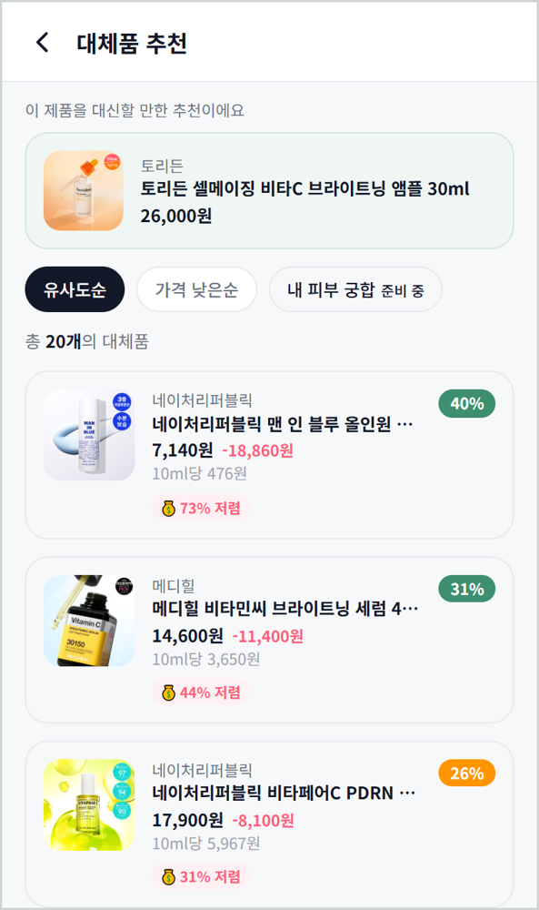
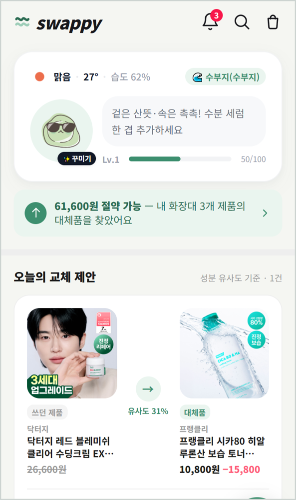
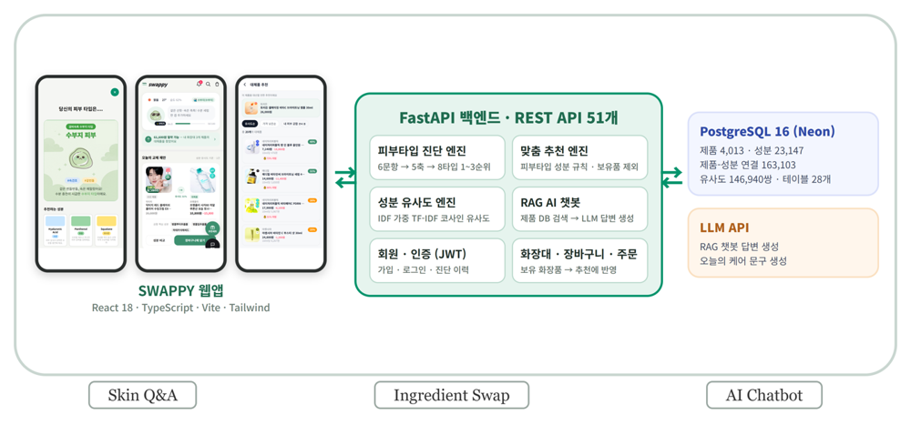

# SWAPPY 데이터 파이프라인 — 한글·영문 동일 화장품 3,666쌍 매칭

> AI 캡스톤디자인(2026, 5인) · **데이터 담당**
> SWAPPY는 쓰던 화장품과 전성분이 비슷하고 더 싼 제품을 찾아 주고, 제품 사진으로 검색하는 웹 앱입니다.
> 팀 저장소는 비공개라, 제가 작성한 데이터 스크립트만 이곳에 정리했습니다.

## 왜 필요했나

사진 속 제품명은 영문으로 찍힌 경우가 많았습니다. 국내 카탈로그만으로는 사진 검색이 영문 제품을 찾지 못해, **같은 상품의 한글·영문 짝**이 필요했습니다.

## 데이터가 흐른 길

```
① 국내 수집·정제          ② 글로벌 수집              ③ 3단계 매칭              ④ 서비스 (팀)
올리브영 국내 5,157건  →  내부 JSON API 12,286건  →  성분 코드 통일 → TF-IDF  →  영문 제품명 3,175건 DB 적재
묶음 분리·카테고리 교정    체크포인트로 이어받기       3,666쌍 + 신뢰도 3등급      → 사진으로 찾기(OCR)
```

①–③이 제 작업이고, ④는 팀이 이 데이터를 받아 서비스에 연결했습니다.

## 스크립트

| 파일 | 줄 수 | 하는 일 |
|---|---:|---|
| [`scripts/collect_global_oliveyoung.py`](scripts/collect_global_oliveyoung.py) | 269 | 올리브영 글로벌(영문) 카테고리 10개 수집. 목록·상세 JSON API를 `requests`로 호출, 수집한 상품번호를 체크포인트에 기록해 중단 후 이어받기 |
| [`scripts/match_kr_en.py`](scripts/match_kr_en.py) | 481 | 국내·글로벌 동일 상품 3단계 매칭, `--eval`로 정확도 검증 |

> 실행에는 국내 정제본(`oliveyoung_products_v5.csv`)과 식약처 성분사전이 필요합니다. 수집 데이터는 저작권 문제로 올리지 않았습니다.

## 3단계 매칭 — 쉬운 것부터, 앞 단계에서 정해진 것은 넘기지 않는다

| 단계 | 방법 | 결과 |
|---|---|---:|
| 1. 전성분 | 식약처 성분사전으로 한·영 성분명을 **같은 코드**로 바꾼 뒤 TF-IDF 코사인 비교. 고신뢰 쌍에서 한↔영 브랜드 대응표를 자동으로 뽑아 다른 브랜드는 걸러냄 | 3,351쌍 |
| 2. 구성 다름 | 국내에만 있는 기획세트·증정 구성은 1:1 배정에서 밀려남 → 같은 브랜드에 전성분이 사실상 같으면(≥ 0.9) 이미 짝이 있어도 묶음 | 298쌍 |
| 3. 상품명 | 전성분이 비어 있는 상품용. 1단계 정답에서 **한↔영 단어 대응표**(크림↔cream, 시카↔cica)를 학습해 이름으로 탐색 | 17쌍 |

### 결과를 믿을 수 있는지

- 매칭마다 신뢰도를 붙였습니다: **높음 3,014 (82%) · 보통 434 (12%) · 확인필요 218 (6%)**
- `--eval` 검증 모드: 1단계 고신뢰 쌍을 정답으로 두고 3단계만으로 같은 답을 찾는지 측정 → 정답이 있을 때 **정확도 약 99%**, 정답이 없을 때 **오채택 약 4%**. 이 수치로 점수 하한 0.6, 1·2등 점수 차 0.12를 정했습니다.

| 방법 | 국내(한글) | 글로벌(영문) | 점수 | 신뢰도 |
|---|---|---|---:|---|
| 전성분 | 3CE 샤인 리플렉터 1.7g 9종 | 3CE Shine Reflector (Set/Single) (9 Colors) | 0.988 | 높음 |
| 구성 다름 | VT 피디알엔 하이드로겔 마스크 4매 | VT PDRN Hydrogel Mask Sheet | 0.908 | 높음 |
| 상품명 | BRTC V10 비타민 필링패드 80매 | BRTC V10 Vitamin Peeling Pads 80 Sheets | 0.907 | 보통 |
| 상품명 | 바이오더마 하이드라비오 세럼 40ml | Bioderma Hydrabio Legere 40ml Double Pack | 0.660 | 확인필요 |

애매한 짝은 버리지 않고 "확인필요"로 남겨, 쓰는 사람이 판단할 수 있게 했습니다.

## 막혔던 지점

| 문제 | 해결 |
|---|---|
| 글로벌 사이트 검색이 봇 차단으로 막힘 | 브라우저 네트워크 탭에서 공개 JSON API를 찾아 브라우저 자동화 없이 수집 |
| 한글·영문 상품명이 서로 다르게 번역됨 | 이름 대신 법정 표기인 **전성분**을 비교 → 91%를 1단계에서 확정 |
| 기획세트가 짝을 못 찾음 | 같은 처방이면 여러 국내 상품을 한 영문 상품에 묶는 2단계 추가 → 298쌍 회수 |
| 시연 준비 중 서버가 DB에 연결되지 않음 | Windows 사용자 폴더가 한글이라 asyncpg SSL 조회가 실패 → 연결 설정 우회, ErrorBoundary 추가 |

## 서비스 화면 (팀 결과물)

| 대체품 추천 | 홈 | 시스템 구성 |
|---|---|---|
|  |  |  |

팀 전체: 제품 4,013건 · 성분 유사도 146,940쌍 · API 58개 · 백엔드 테스트 385건 통과 · React + FastAPI + PostgreSQL
