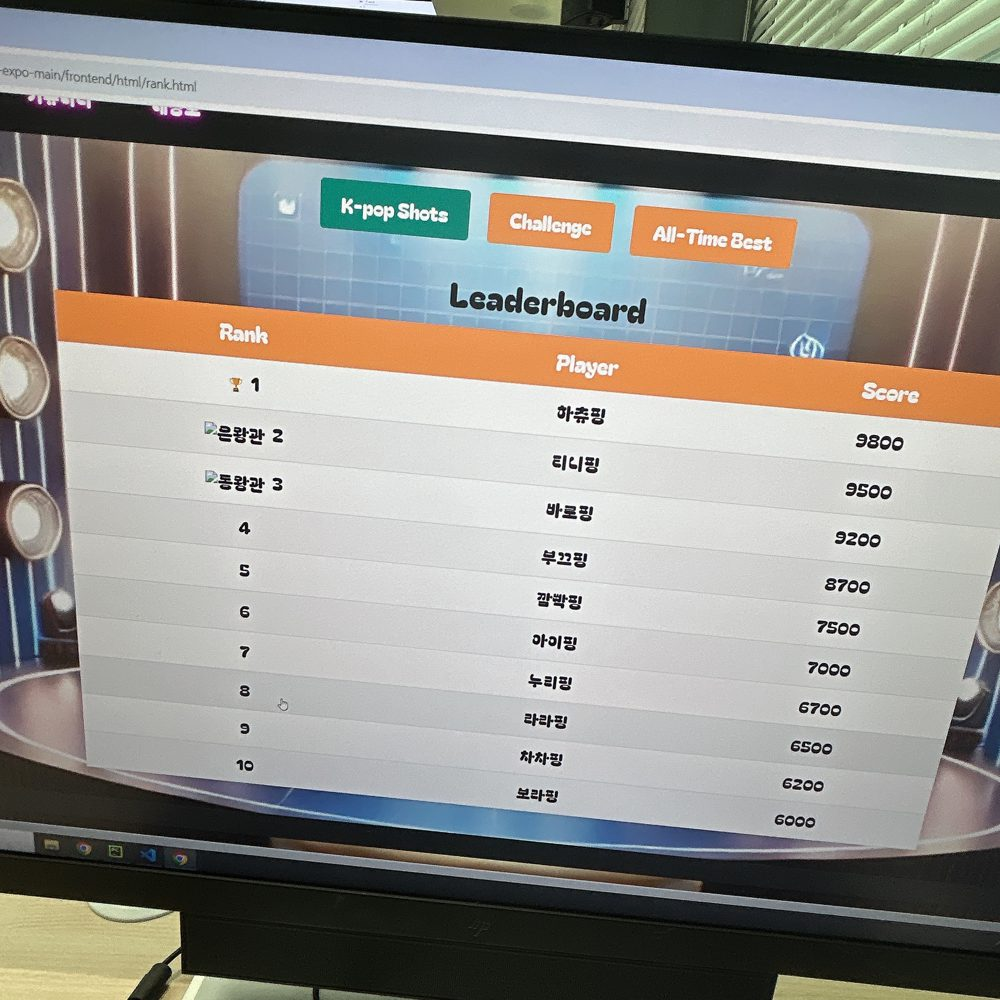
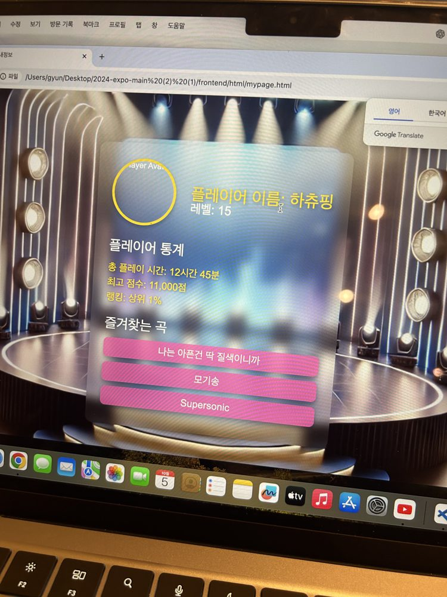
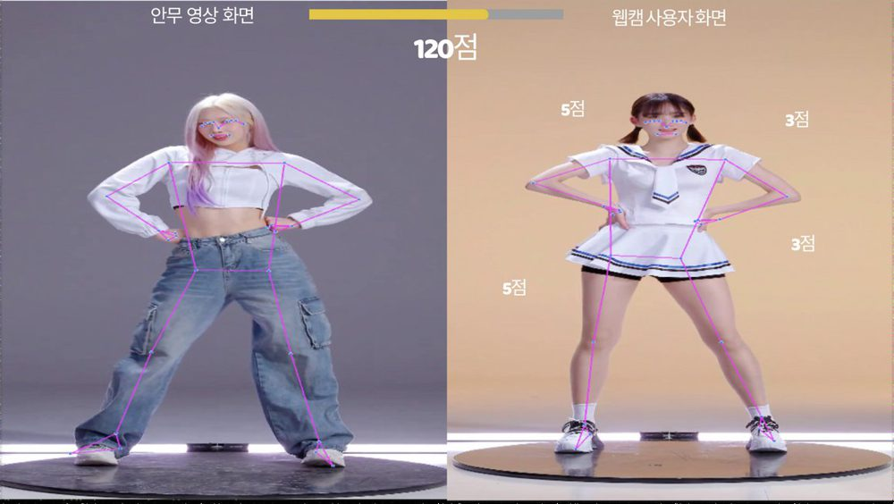

# K-DANCE-CHALLENGE — 동작 인식 댄스 챌린지

> 동양미래EXPO 2024 · 전공동아리 FLUFFY · 7인 · 지도교수 김유두
> 내 역할: **기획 담당** + **랭킹·마이페이지 구현**
> 팀 저장소: [uh004/2024-expo](https://github.com/uh004/2024-expo)

카메라로 사용자의 춤 동작을 인식하고, 챌린지 영상과의 유사도로 점수를 매기는 웹 서비스입니다.

## 내가 만든 화면

| 랭킹 페이지 | 마이페이지 |
|---|---|
|  |  |
| 카테고리 버튼(K-pop Shots / Challenge / All-Time Best)을 누르면 JavaScript가 순위표를 다시 그리고, 1–3위에 메달을 붙입니다 | 프로필·플레이 통계·즐겨찾는 곡을 데이터 객체에서 읽어 화면에 렌더링합니다 |

코드: [`web/rank.html`](web/rank.html) · [`rank.css`](web/rank.css) · [`rank.js`](web/rank.js) · [`mypage.html`](web/mypage.html) · [`mypage.css`](web/mypage.css) · [`mypage.js`](web/mypage.js)

> 서버 연동 전 단계라 예시 데이터로 화면 구조를 먼저 완성했고, 데이터 연동은 백엔드 담당이 진행했습니다.

## 내가 쓴 기획 문서

- [`planning/01_기획.md`](planning/01_기획.md) — 시장·경쟁 분석(STEEZY, Just Dance), 타깃, 차별화 요소, 핵심 기능, 비즈니스 모델, 마케팅
- [`planning/02_세분화된_기획.md`](planning/02_세분화된_기획.md) — 사용자 세분화, 포인트·배지·일일 미션 같은 참여 유지 장치, 콘텐츠 다양화, AI 고도화, 수익 모델, 장기 성장 전략

## 팀이 만든 채점 흐름

```
① 관절 추출 (MediaPipe) → ② L2 정규화로 크기 맞춤 → ③ DTW로 박자 차이 흡수 → ④ 코사인 유사도로 자세 비교 → 점수
```



## 협업

매주 화요일 정기 회의 · GitHub · Figma · 노션(회의록, 간트 차트, 파트별 코드 보고서)
