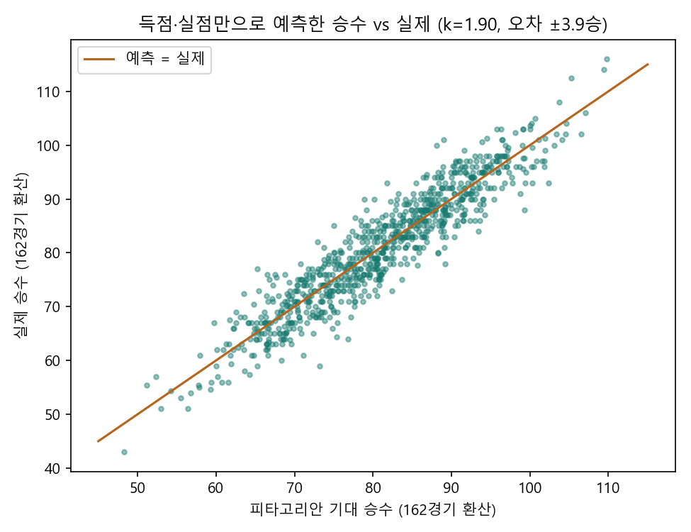
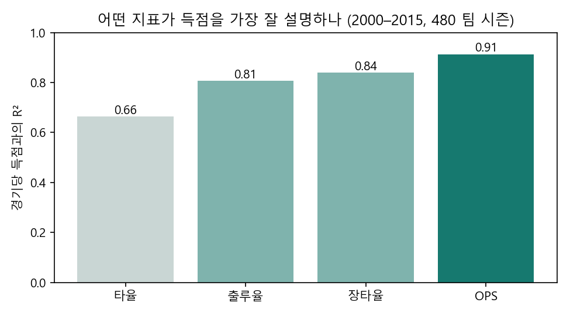
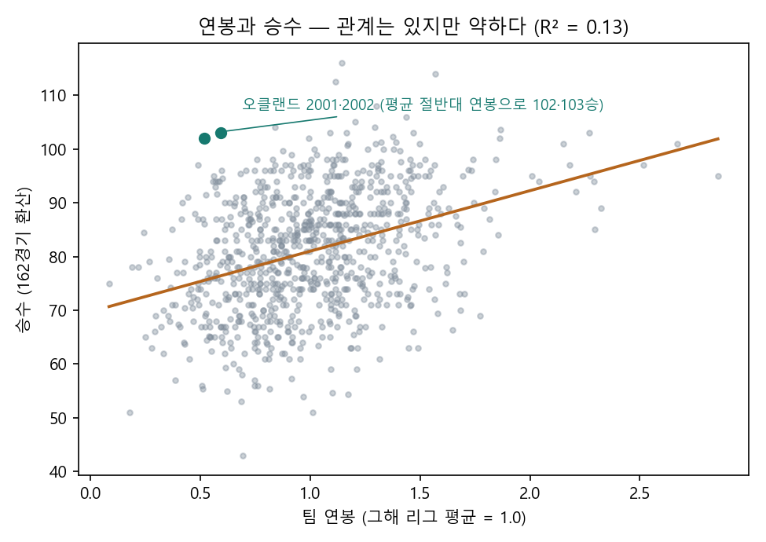

# MLB 팀 기록으로 본 "승리는 어디서 오는가"

> 개인 분석 · Python · pandas · NumPy · matplotlib
> 좋아하는 야구를 해설 대신 기록으로 확인해 보고 싶어 시작했습니다. 전체 코드와 출력은 [`mlb_analysis.ipynb`](mlb_analysis.ipynb)에 있습니다.

데이터: Lahman Baseball Database (1871–2015) 중 팀 시즌 기록 `Teams.csv`와 선수 연봉 `Salaries.csv`. 연봉 데이터가 있는 **1985–2015년**을 쓰고, 파업으로 시즌이 짧았던 1994년은 뺐습니다(팀 시즌 860개).

## 한눈에

| 질문 | 답 |
|---|---|
| 승률은 무엇으로 결정되나 | 경기당 **득실차가 승률 변동의 87%**를 설명. 득실차 약 **10점 = 1승** |
| 득점은 무엇이 만드나 | **OPS(R² 0.91)** > 장타율(0.84) > 출루율(0.81) > 타율(0.66). 출루율 1포인트 ≈ 장타율 **1.55포인트** |
| 연봉으로 승리를 사나 | 경향은 있지만 **설명력 13%**. 2001–02 오클랜드는 리그 평균 절반대 연봉으로 102·103승 |

## 1. 득점과 실점만으로 승률을 맞출 수 있을까

빌 제임스의 피타고리안 기대승률 `득점^k / (득점^k + 실점^k)`에서 지수 k를 1.50–2.60 사이 0.01 단위로 바꿔 가며 실제 승률과의 오차가 가장 작은 값을 찾았습니다.



- 최적 지수 **k = 1.90** (빌 제임스가 제안한 2와 거의 같음), 한 시즌 오차 **±3.9승**
- 경기당 득실차의 설명력 **R² = 0.87**, 1승 ≈ 득실차 **9.8점**

## 2. 득점을 가장 잘 설명하는 공격 지표는?

희생플라이·사구가 모든 팀에 기록된 2000–2015년 480개 팀 시즌으로 범위를 좁혀 비교했습니다.



- 가장 익숙한 타율보다 **출루율·장타율이 득점을 더 잘 설명**하고, 둘을 더한 OPS가 가장 좋습니다
- 회귀식: `경기당 득점 ≈ −5.33 + 16.59×OBP + 10.73×SLG` → 출루율 1포인트가 장타율 1포인트의 **1.55배**. 영화 「머니볼」에서 오클랜드가 출루율에 주목한 이유와 같은 결론입니다

## 3. 연봉으로 승리를 살 수 있을까

해마다 리그 전체 연봉 수준이 달라서, 팀 연봉을 **그해 리그 평균 대비 비율**로 바꿔 비교했습니다.



| 연봉 구간 | 평균 승수 (162경기) | 포스트시즌 진출률 |
|---|---:|---:|
| 하위 25% | 75.8 | 12% |
| 25–50% | 79.0 | 19% |
| 50–75% | 83.1 | 27% |
| 상위 25% | 86.1 | 41% |

- 돈을 많이 쓰는 팀이 더 이기는 경향은 분명하지만(r = 0.37), 연봉이 설명하는 승률 변동은 **13%**뿐입니다
- 리그 평균의 60% 이하 연봉으로 가장 많이 이긴 팀 1–2위가 2002·2001년 오클랜드(103승, 102승)입니다

## 한계와 다음 단계

- 팀 단위 집계라 선수 개인의 기여, 수비·구장 효과는 보지 않았습니다
- 다음에는 선수 단위 기록(`Batting.csv`)으로 "연봉 대비 OPS가 높은 선수"를 찾아보고 싶습니다

## 실행

```bash
pip install pandas numpy matplotlib jupyter
jupyter notebook mlb_analysis.ipynb
```

데이터 출처: [Lahman Baseball Database](http://www.seanlahman.com/baseball-archive/statistics/) (CC BY-SA 3.0). `data/` 폴더의 CSV 두 개는 이 데이터베이스에서 가져왔습니다.
