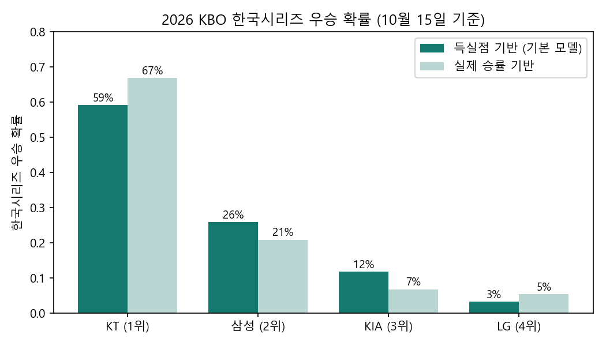
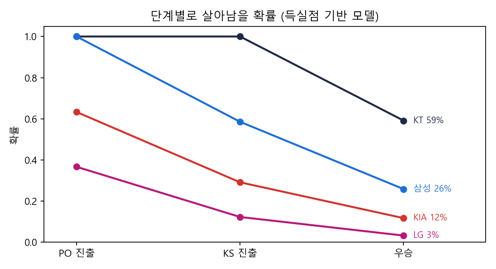

# 2026 KBO 가을야구 — 우승 확률 예측

> 개인 분석 · **2026년 10월 15일 기준** (정규시즌 종료, 와일드카드 LG 4-1 두산 반영)
> Python · pandas · NumPy · matplotlib · 몬테카를로 시뮬레이션 — 전체 코드: [`kbo_2026_postseason.ipynb`](kbo_2026_postseason.ipynb)

## 결론

| 팀 (정규시즌 순위) | 우승 확률 (득실점 기반) | 실제 승률 기반 |
|---|---:|---:|
| **KT** (1위, 90승 5무 49패) | **59%** | 67% |
| 삼성 (2위) | 26% | 21% |
| KIA (3위) | 12% | 7% |
| LG (4위) | 3% | 5% |

**KT가 가장 유력합니다.** 득실차 +176으로 실력 자체가 가장 높고, 한국시리즈에 직행해 7경기 중 4경기를 홈에서 치릅니다. 모델을 바꿔도 KT 우세라는 결론은 같습니다.

## 방법

1. **팀 실력 = 피타고리안 승률.** 승패에는 접전의 운이 섞이므로 득점·실점으로 실력을 추정했습니다. 지수 k는 2026 KBO 10개 팀 기록에 가장 잘 맞는 **1.84**를 썼습니다 (144경기 기준 오차 ±5.1승).
2. **한 경기 승률 = Log5 + 홈 이점.** 두 팀의 실력으로 맞대결 승률을 구하고(빌 제임스의 Log5), 2026 리그 홈 승률 .515에서 구한 **홈 이점 +1.5%p**를 더했습니다.
3. **시리즈 = 실제 대진·경기 수·홈 배정.**

   | 단계 | 대진 | 방식 | 상위 시드 홈 |
   |---|---|---|---|
   | 준플레이오프 | KIA vs LG | 5전 3선승 | 1·2·5차전 |
   | 플레이오프 | 삼성 vs 준PO 승자 | 5전 3선승 | 1·2·5차전 |
   | 한국시리즈 | KT vs PO 승자 | 7전 4선승 | 1·2·6·7차전 |

4. **확률은 정확히 계산하고, 10만 번 시뮬레이션으로 검증했습니다.** 두 결과의 차이는 0.2%p 이내입니다.

## 눈에 띄는 점

| 팀 | 득점 | 실점 | 득실차 | 실제 승률 | 피타고리안 |
|---|---:|---:|---:|---:|---:|
| KT | 825 | 649 | +176 | .647 | .608 |
| 삼성 | 806 | 669 | +137 | .589 | .584 |
| KIA | 769 | 664 | +105 | .556 | .567 |
| LG | 723 | 726 | −3 | .545 | .498 |
| 두산 | 688 | 630 | +58 | .525 | .540 |

- **LG는 득실차가 −3인데 78승**을 거뒀습니다. 득실점으로 기대되는 승수보다 약 7승을 더 이긴 셈이라, 득실점 모델에서는 실력이 .500 수준으로 평가됩니다. 그래서 준PO에서 KIA가 이길 확률이 **63%**로 나옵니다.
- **두산은 득실차 +58로 실력은 4위급**이었지만, 와일드카드 1경기 만에 탈락했습니다. 단기전의 변동성을 보여 주는 사례입니다.

## 한계

- 선발 로테이션(에이스 등판 순서), 부상, 휴식일 효과는 넣지 않았습니다
- 시즌 전체 평균 실력이라 최근 흐름(KT 마지막 10경기 9승 1무, 삼성 4승 6패)은 반영하지 않았습니다
- 포스트시즌 무승부는 없다고 가정했습니다
- 결과가 나오면 실제와 비교해 이 README를 업데이트할 예정입니다

## 데이터

[`data/kbo_2026_regular_season.csv`](data/kbo_2026_regular_season.csv) — 팀별 승·패·무, 득점·실점, 홈/원정 전적
출처: [스탯티즈](https://www.statiz.co.kr/) 팀 순위, [KBO 대시보드](https://kbo-dashboard.co.kr/standings/) (2026년 10월 12일 정규시즌 종료 기준) · 와일드카드 결과: [일간스포츠](https://isplus.com/article/view/isp202610140257)
